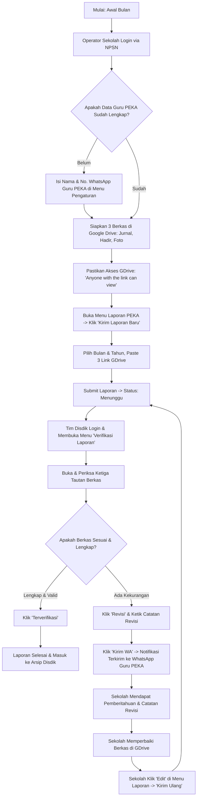
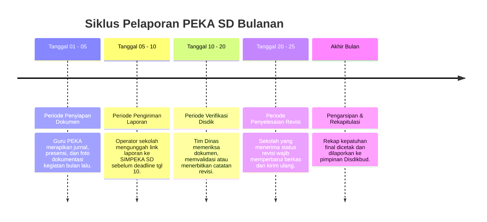

# BUKU PANDUAN OPERASIONAL & BLUEPRINT PENGGUNAAN
# SIMPEKA SD (Sistem Informasi Manajemen Pelaporan Sekolah Dasar)
### Dinas Pendidikan dan Kebudayaan Kabupaten Tabalong

---

**Versi Dokumen:** 1.0  
**Tanggal Rilis:** 2026  
**Pengembang Sistem:** Masfy - MfyTech ([www.mfytech.my.id](https://www.mfytech.my.id))  
**Sasaran Pembaca:** Operator Sekolah Dasar (SD), Guru PEKA, Tim Verifikator Disdikbud, dan Administrator Sistem.

---

## DAFTAR ISI

1. [PENDAHULUAN & GAMBARAN UMUM SISTEM](#1-pendahuluan--gambaran-umum-sistem)
   - 1.1 Latar Belakang & Tujuan
   - 1.2 Manfaat Aplikasi
   - 1.3 Karakteristik & Fitur Unggulan (PWA, Realtime, Cloud-Based)
2. [HAK AKSES PENGGUNA (ROLE MATRIX)](#2-hak-akses-pengguna-role-matrix)
3. [BLUEPRINT & ALUR KERJA SISTEM (WORKFLOWS)](#3-blueprint--alur-kerja-sistem-workflows)
   - 3.1 Alur Utama Pelaporan & Verifikasi Bulanan
   - 3.2 Alur Penanganan Revisi Laporan & Notifikasi WhatsApp
   - 3.3 Jadwal & Siklus Pelaporan Rutin
4. [PANDUAN PENGGUNAAN: OPERATOR SEKOLAH DASAR (SD)](#4-panduan-pengguna-operator-sekolah-dasar-sd)
   - 4.1 Login & Akses Aplikasi (Desktop & HP / PWA)
   - 4.2 Langkah Wajib: Mengisi & Memperbarui Data Guru PEKA
   - 4.3 Panduan Mengatur Berkas di Google Drive (Public Access)
   - 4.4 Mengirim Laporan Bulanan Baru
   - 4.5 Memantau Status Laporan di Dashboard
   - 4.6 Tata Cara Memperbaiki Laporan Berstatus "Revisi"
   - 4.7 Mengakses Surat Keputusan (SK) Disdik
   - 4.8 Melihat Dokumentasi & Galeri Kegiatan
   - 4.9 Mengubah Password Akun Sekolah
5. [PANDUAN PENGGUNAAN: TIM DINAS PENDIDIKAN (DISDIK)](#5-panduan-pengguna-tim-dinas-pendidikan-disdik)
   - 5.1 Dashboard Analitik & Kepatuhan Pelaporan
   - 5.2 Prosedur Verifikasi Laporan Sekolah
   - 5.3 Menghubungi Guru PEKA via Notifikasi WhatsApp Otomatis
   - 5.4 Manajemen Arsip Laporan & Ekspor Excel (.xlsx)
   - 5.5 Manajemen Data Sekolah (Tambah SD, Edit, Reset Password, Cetak Akun)
   - 5.6 Manajemen Surat Keputusan (SK) Resmi
   - 5.7 Manajemen Galeri Dokumentasi Kegiatan
   - 5.8 Pengaturan Akun Admin & Fitur Backup Data
6. [STANDAR OPERASIONAL PROSEDUR (SOP) BERKAS GOOGLE DRIVE](#6-standar-operasional-prosedur-sop-berkas-google-drive)
7. [PANDUAN TROUBLESHOOTING & PERTANYAAN UMUM (FAQ)](#7-panduan-troubleshooting--pertanyaan-umum-faq)
8. [INFORMASI KONTAK & BANTUAN TEKNIS](#8-informasi-kontak--bantuan-teknis)

---

## 1. PENDAHULUAN & GAMBARAN UMUM SISTEM

### 1.1 Latar Belakang & Tujuan
**SIMPEKA SD** (*Sistem Informasi Manajemen Pelaporan Sekolah Dasar*) dirancang untuk memodernisasi dan menyederhanakan alur pengumpulan, pemeriksaan, serta pengarsipan laporan program **PEKA** dari seluruh Sekolah Dasar negeri dan swasta di Kabupaten Tabalong.

Sebelum adanya sistem ini, pelaporan seringkali menghadapi kendala seperti:
- Berkas fisik menumpuk dan rentan hilang/rusak.
- Pengiriman file melalui chat terpisah-pisah, menyulitkan rekapitulasi.
- Sekolah kesulitan memantau apakah laporannya sudah disetujui atau memerlukan perbaikan.
- Disdikbud membutuhkan waktu lama untuk mengetahui sekolah mana saja yang belum melapor.

Dengan SIMPEKA SD, seluruh proses dilakukan secara terpusat, transparan, cepat, dan berbasis digital melalui tautan dokumen awan (*cloud*).

### 1.2 Manfaat Aplikasi
- **Bagi Sekolah Dasar:** Kepastian status laporan secara real-time, kemudahan revisi tanpa perlu cetak ulang berkas fisik, serta kemudahan akses dokumen resmi (SK) langsung dari Dinas.
- **Bagi Dinas Pendidikan & Kebudayaan:** Rekapitulasi otomatis tingkat kepatuhan per kecamatan/bulan, verifikasi satu pintu, arsip data tersusun rapi, dan fasilitas kontak instan via WhatsApp ke guru pembina/operator bersangkutan.
- **Bagi Pimpinan:** Dashboard statistik akurat mengenai kepatuhan pelaporan pendidikan dasar se-Kabupaten Tabalong.

### 1.3 Karakteristik & Fitur Unggulan
- **PWA (Progressive Web App):** Aplikasi dapat dipasang (*install*) di layar utama *smartphone* (Android/iOS) maupun laptop tanpa perlu download dari Play Store/App Store.
- **Google Drive Integration:** Tidak membebani kuota penyimpanan lokal, dokumen tersimpan aman di Google Drive sekolah dan dapat diakses kapan saja oleh verifikator.
- **WhatsApp Direct Connect:** Dinas dapat mengirim notifikasi revisi berkas langsung ke nomor WhatsApp Guru PEKA dengan pesan yang otomatis terformat.
- **Export Data Excel:** Dinas dapat mengunduh seluruh rekap laporan per tahun, per bulan, atau per kecamatan hanya dengan sekali klik.

---

## 2. HAK AKSES PENGGUNA (ROLE MATRIX)

Aplikasi SIMPEKA SD membagi hak akses ke dalam 3 level pengguna:

| Modul / Fitur | Pengunjung Publik | Sekolah Dasar (SD) | Dinas Pendidikan (Disdik) |
|---|:---:|:---:|:---:|
| **Portal Publik & Statistik Global** | ✅ Lihat Saja | ✅ Lihat Saja | ✅ Lihat Saja |
| **Login Akun (NPSN / Kredensial Admin)** | ❌ | ✅ | ✅ |
| **Dashboard Sekolah** | ❌ | ✅ | ❌ |
| **Dashboard Dinas (Statistik & Grafik)** | ❌ | ❌ | ✅ |
| **Input & Edit Data Guru PEKA** | ❌ | ✅ (Data Sendiri) | ✅ (Lihat saat Verifikasi) |
| **Kirim Laporan Bulanan (3 Link GDrive)** | ❌ | ✅ | ❌ |
| **Verifikasi Laporan (Setujui / Revisi)** | ❌ | ❌ | ✅ |
| **Kirim Notifikasi Revisi via WhatsApp** | ❌ | ❌ | ✅ |
| **Arsip Laporan & Ekspor ke Excel** | ❌ | ❌ | ✅ |
| **Unduh Dokumen SK Resmi** | ❌ | ✅ (Akses Unduh) | ✅ (Kelola & Upload) |
| **Galeri Dokumentasi Kegiatan** | ❌ | ✅ (Lihat Galeri) | ✅ (Kelola & Upload Foto) |
| **Kelola Master Data Sekolah & Reset Password** | ❌ | ❌ | ✅ |
| **Pengaturan Akun & Ubah Password** | ❌ | ✅ (Akun Sekolah) | ✅ (Akun Admin) |

---

## 3. BLUEPRINT & ALUR KERJA SISTEM (WORKFLOWS)

### 3.1 Alur Utama Pelaporan & Verifikasi Bulanan

Berikut adalah diagram alur proses pelaporan dari awal hingga laporan terverifikasi:



### 3.2 Siklus Bulanan & Batas Waktu Pelaporan



> [!IMPORTANT]
> **Tenggat Waktu Pelaporan:**  
> Laporan bulan berjalan diimbau untuk dikirimkan **selambat-lambatnya tanggal 10 pada bulan berikutnya**. Keterlambatan akan tercatat pada dashboard kepatuhan dinas.

---

## 4. PANDUAN PENGGUNA: OPERATOR SEKOLAH DASAR (SD)

Bagian ini memandu operator dan guru pembina di satuan pendidikan Sekolah Dasar.

### 4.1 Login & Akses Aplikasi

1. Buka peramban (*browser*) rekomendasi: **Google Chrome** (Android/Windows) atau **Safari** (iOS/Mac).
2. Akses alamat web SIMPEKA SD: `https://simpeka-sd.web.app` (atau domain resmi Disdikbud).
3. Di halaman depan, klik tombol **"Masuk"** di pojok kanan atas.
4. Masukkan kredensial login:
   - **NPSN / Username:** Masukkan 8 digit NPSN sekolah Anda (contoh: `30304xxx`).
   - **Password Default:** `pekasd`
5. Klik **"Masuk ke Portal"**.
6. *(Opsional - Sangat Disarankan)* **Pasang sebagai Aplikasi (PWA):**
   - Di Android Chrome: Klik ikon titik tiga di kanan atas $\rightarrow$ Pilih **"Tambahkan ke Layar Utama" / "Install SIMPEKA SD"**.
   - Di iPhone Safari: Klik tombol Share $\rightarrow$ Pilih **"Add to Home Screen"**.

---

### 4.2 Langkah Wajib: Mengisi Data Guru PEKA

> [!WARNING]
> Sebelum Anda dapat mengirimkan laporan, Anda **wajib** mengisi data Guru PEKA terlebih dahulu. Nomor WhatsApp ini adalah jalur komunikasi utama Dinas Pendidikan saat memberikan catatan revisi!

**Langkah-langkah:**
1. Masuk ke menu **Pengaturan** di bilah navigasi samping (atau navigasi bawah jika memakai ponsel).
2. Pada bagian **"Data Guru PEKA"**, klik tombol **"Tambah Guru"**.
3. Masukkan:
   - **Nama Lengkap Guru:** Lengkap dengan gelar jika ada.
   - **Nomor HP / WhatsApp Aktif:** Awali dengan format standar (contoh: `081234567890`).
4. Klik **"Tambah"**.
5. Jika ada lebih dari satu guru pembina, Anda dapat menambahkan guru kedua. Guru pertama dalam daftar akan dijadikan kontak utama oleh sistem.

---

### 4.3 Panduan Mengatur Berkas di Google Drive

Aplikasi SIMPEKA SD tidak mengunggah file fisik secara langsung, melainkan menggunakan **tautan Google Drive**. Tujuannya agar sekolah memiliki arsip dokumen sendiri secara rapi tanpa batas ukuran file sistem.

**3 Berkas yang Wajib Disiapkan:**
1. **Jurnal Kegiatan PEKA** (Format PDF / Google Docs).
2. **Daftar Hadir / Presensi Kegiatan** (Format PDF / Spreadsheet).
3. **Dokumentasi Foto Kegiatan** (Format Folder GDrive berisi foto kegiatan atau file PDF kompilasi foto).

**Cara Mengatur Hak Akses Google Drive (Wajib Dilakukan!):**
1. Buka [drive.google.com](https://drive.google.com) dan cari file/folder yang ingin dibagikan.
2. Klik kanan pada file/folder tersebut $\rightarrow$ Pilih **Bagikan (Share)** $\rightarrow$ **Bagikan (Share)**.
3. Pada bagian **Akses umum (General access)**, ubah dari *"Dibatasi (Restricted)"* menjadi:
   $$\mathbf{Siapa\ saja\ yang\ memiliki\ link\ (Anyone\ with\ the\ link)}$$
4. Pastikan perannya adalah **Pelihat (Viewer)**.
5. Klik **Salin link (Copy link)** lalu klik **Selesai**.

> [!CAUTION]
> Jangan biarkan file dalam status **"Dibatasi" (Restricted)**! Tim verifikator tidak akan bisa membuka berkas dan laporan Anda otomatis akan diberi status **Revisi**.

---

### 4.4 Mengirim Laporan Bulanan Baru

1. Masuk ke menu **"Laporan PEKA"**.
2. Klik tombol kuning **"+ Kirim Laporan Baru"** di sudut kanan atas.
3. Pada jendela yang terbuka:
   - **Bulan & Tahun Laporan:** Pilih bulan dan tahun yang sesuai dengan kegiatan yang dilaporkan (misalnya: *Maret 2026*).
   - **Link Jurnal Kegiatan:** Tempelkan (*paste*) link Google Drive jurnal kegiatan (harus diawali `https://`).
   - **Link Daftar Hadir:** Tempelkan link Google Drive daftar absensi.
   - **Link Dokumentasi Kegiatan:** Tempelkan link Google Drive album foto/dokumentasi.
4. Klik **"Kirim Laporan"**.
5. Laporan Anda berhasil tercatat dengan status awal **"Menunggu"**.

*Catatan: Sistem membatasi 1 laporan per bulan per sekolah. Jika Anda sudah pernah mengirim laporan pada bulan tersebut, sistem akan menolak laporan duplikat.*

---

### 4.5 Memantau Status Laporan di Dashboard

Anda dapat mengecek status laporan kapan saja pada menu **Dashboard** atau **Laporan PEKA**. Tiga kemungkinan status laporan:

```
[ Menunggu ]      --> Berkas sudah diterima sistem dan berada dalam antrean pemeriksaan Disdik.
[ Terverifikasi ] --> Berkas telah diperiksa dan disetujui penuh oleh tim verifikator Disdik.
[ Revisi ]        --> Berkas belum memenuhi syarat atau tautan tidak dapat dibuka. Perlu perbaikan segera!
```

---

### 4.6 Tata Cara Memperbaiki Laporan Berstatus "Revisi"

Jika laporan sekolah Anda dinyatakan **Revisi**, lakukan langkah-langkah berikut:
1. Buka menu **Laporan PEKA**.
2. Cari laporan yang berstatus **Revisi** (berwarna merah).
3. Klik untuk melihat **Catatan Revisi** dari verifikator (misal: *"Link jurnal terkunci / perbaiki tanda tangan pada presensi"*).
4. Perbaiki berkas fisik/digital Anda di Google Drive sesuai arahan catatan.
5. Pada baris laporan terkait, klik tombol **"Pencil / Edit"**.
6. Perbarui link jika berkas diganti, atau biarkan jika Anda langsung mengedit file di dalam link GDrive yang sama.
7. Klik **"Kirim Ulang Laporan"**.
8. Status laporan akan otomatis kembali menjadi **"Menunggu"** untuk diverifikasi ulang oleh Disdikbud.

---

### 4.7 Mengakses Dokumen SK Disdik

1. Buka menu **"SK Disdik"** di navigasi samping.
2. Anda akan melihat daftar Surat Keputusan resmi yang diterbitkan oleh Dinas Pendidikan dan Kebudayaan.
3. Anda dapat menggunakan kolom pencarian berdasarkan nomor surat atau judul SK.
4. Klik tombol **"Buka SK / Unduh"** untuk membuka dokumen PDF resmi di Google Drive dinas.

---

### 4.8 Melihat Dokumentasi & Galeri Kegiatan

1. Buka menu **"Dokumentasi"**.
2. Menu ini menampilkan galeri kegiatan PEKA tingkat kabupaten, sosialisasi, bimbingan teknis, atau pengumuman visual lainnya.
3. Klik tombol tautan kegiatan jika tersedia untuk membaca dokumentasi lengkap atau membuka album eksternal.

---

### 4.9 Mengubah Password Akun Sekolah

Untuk menjaga keamanan akun sekolah:
1. Masuk ke menu **Pengaturan**.
2. Gulir ke bawah ke bagian **"Keamanan & Kata Sandi"**.
3. Masukkan:
   - **Password Lama:** (Default awal: `pekasd` atau password terakhir).
   - **Password Baru:** Minimal 8 karakter kombinasi huruf dan angka.
   - **Konfirmasi Password Baru:** Ketik ulang password baru yang sama persis.
4. Klik **"Perbarui Kata Sandi"**.
5. Catat dan simpan password baru di tempat yang aman. Jika lupa password, hubungi admin Disdikbud untuk reset.

---

## 5. PANDUAN PENGGUNA: TIM DINAS PENDIDIKAN (DISDIK)

Bagian ini memandu staf, verifikator, dan administrator pada Dinas Pendidikan dan Kebudayaan Kabupaten Tabalong.

### 5.1 Dashboard Analitik & Kepatuhan Pelaporan

Halaman Dashboard menyajikan ringkasan eksekutif secara real-time:
- **Kartu Statistik Cepat:**
  - Total Seluruh Laporan yang Masuk.
  - Jumlah Laporan Berstatus *Menunggu Verifikasi* (Antrean aktif).
  - Jumlah Laporan Berstatus *Perlu Revisi*.
  - Jumlah Laporan *Terverifikasi*.
  - Total Sekolah Dasar yang Sudah Aktif Melapor.
- **Filter Fleksibel:** Verifikator dapat menyaring data berdasarkan **Tahun** dan **Bulan** tertentu.
- **Daftar Laporan Terkini:** Memantau sekolah mana saja yang baru saja mengirimkan berkas dalam beberapa jam/hari terakhir.

---

### 5.2 Prosedur Verifikasi Laporan Sekolah

1. Klik menu **"Verifikasi Laporan"** di navigasi utama.
2. Gunakan tab status di bagian atas:
   - **Semua:** Menampilkan semua kiriman.
   - **Menunggu:** Laporan yang membutuhkan tindak lanjut verifikator.
   - **Revisi:** Laporan yang sedang menunggu perbaikan dari sekolah.
   - **Terverifikasi:** Laporan yang sudah disetujui.
3. Anda dapat memfilter berdasarkan **Tahun, Bulan**, dan mencari nama sekolah atau NPSN.
4. Klik pada baris laporan atau klik tombol **"Periksa / Aksi"** untuk membuka pop-up verifikasi.
5. Di dalam modal verifikasi:
   - Klik tombol **"Jurnal Kegiatan"** $\rightarrow$ Periksa kelayakan isi kegiatan.
   - Klik tombol **"Daftar Hadir"** $\rightarrow$ Periksa presensi peserta/guru.
   - Klik tombol **"Dokumentasi"** $\rightarrow$ Periksa bukti fisik foto kegiatan.
6. **Keputusan Verifikator:**
   - **Jika Lengkap & Sah:** Klik tombol hijau **"Terverifikasi"**. Status laporan akan berubah menjadi Terverifikasi.
   - **Jika Terdapat Kekurangan / Link Terkunci:**
     1. Masukkan poin-poin kekurangan pada kolom **"Catatan Revisi"** (Contoh: *"Akses link jurnal masih dikunci, mohon ubah ke publik. Absensi belum dicap kepala sekolah"*).
     2. Klik tombol merah **"Minta Revisi"**.
     3. Sistem akan memunculkan konfirmasi pengiriman pesan WhatsApp ke Guru PEKA.

---

### 5.3 Menghubungi Guru PEKA via Notifikasi WhatsApp Otomatis

Salah satu keunggulan SIMPEKA SD adalah integrasi tombol WhatsApp instan:
1. Ketika verifikator menetapkan status **Revisi**, sistem secara otomatis mengambil nomor kontak WhatsApp Guru PEKA sekolah tersebut yang tersimpan di database.
2. Muncul jendela pratinjau pesan WhatsApp yang berisi:
   - Identitas Sekolah & NPSN.
   - Periode Laporan.
   - Catatan Revisi yang baru saja diketik.
   - Tautan langsung ke portal SIMPEKA SD untuk memudahkan guru melakukan revisi.
3. Klik tombol hijau **"Kirim WA"**.
4. Browser akan otomatis membuka aplikasi WhatsApp Desktop atau WhatsApp Web dengan pesan yang sudah terformat rapi. Verifikator cukup menekan tombol *Enter/Kirim* di WhatsApp.

---

### 5.4 Manajemen Arsip Laporan & Ekspor Excel (.xlsx)

1. Buka menu **"Arsip Laporan"**.
2. Halaman ini merekam seluruh data riwayat laporan secara permanen.
3. Fitur yang tersedia:
   - **Pencarian Multi-Kriteria:** Filter berdasarkan Tahun, Bulan, dan Kecamatan (12 Kecamatan se-Tabalong).
   - **Ekspor Excel:** Klik tombol **"Unduh Excel"** untuk mengekstrak seluruh data rekapitulasi ke dalam berkas Spreadsheet `.xlsx` rapi yang siap dicetak untuk lampiran laporan dinas.
   - **Koreksi Darurat:** Verifikator senior dapat mengubah status atau menghapus laporan yang salah kirim melalui tombol aksi di tabel arsip.

---

### 5.5 Manajemen Data Sekolah (Data Master)

Buka menu **"Data Sekolah"** untuk mengelola master data seluruh SD di Tabalong:
1. **Tambah Sekolah Baru:**
   - Klik tombol **"+ Tambah Sekolah"**.
   - Masukkan Nama SD, NPSN (8 digit), dan pilih Kecamatan.
   - Sistem secara otomatis membuat akun login dengan email default `[npsn]@simpekasd.id` dan password default `pekasd`.
2. **Ubah Informasi Sekolah:**
   - Klik tombol edit (pensil) pada baris sekolah untuk memperbarui nama instansi resmi jika terjadi perubahan penamaan.
3. **Cetak Kredensial / Slip Login Sekolah:**
   - Tersedia tombol cetak slip akun sekolah untuk dibagikan saat sosialisasi atau kegiatan MGMP/KKG.
4. **Ekspor Data Sekolah:**
   - Dapat diunduh dalam format Excel atau PDF master list.

---

### 5.6 Manajemen Surat Keputusan (SK) Resmi

1. Buka menu **"Kelola SK"**.
2. Klik tombol **"+ Tambah SK"**.
3. Masukkan:
   - **Nomor Surat:** (Contoh: `421.2/123/DISDIKBUD/2026`)
   - **Judul SK:** (Contoh: `SK Penetapan Guru Pembina PEKA SD Tahun Ajaran 2026/2027`)
   - **Tautan Google Drive:** Masukkan tautan berkas PDF SK yang tersimpan di Google Drive Dinas (pastikan akses link sudah disetel publik).
4. Klik **"Simpan SK"**. Seluruh operator SD sekarang dapat langsung mengunduh dan membaca SK tersebut dari dashboard mereka.

---

### 5.7 Manajemen Galeri Dokumentasi Kegiatan

1. Buka menu **"Kelola Dokumentasi"**.
2. Klik tombol **"+ Unggah Dokumentasi"**.
3. Masukkan:
   - **Judul Kegiatan:** (Contoh: `Monitoring & Evaluasi Program PEKA Zona Selatan`)
   - **Deskripsi Singkat Kegiatan.**
   - **Link Tautan Liputan / Album GDrive.**
   - **File Foto Thumbnail:** Unggah satu foto unggulan (format JPG/PNG) yang akan dijadikan sampul galeri.
4. Klik **"Unggah"**. File foto akan disimpan di Firebase Storage dan langsung tayang pada galeri portal.

---

### 5.8 Pengaturan Akun Admin & Fitur Backup Data

1. Buka menu **"Pengaturan"**.
2. **Ganti Kata Sandi Admin:**
   - Masukkan password lama dan password baru untuk mengamankan akses panel admin Dinas.
3. **Pencadangan Database (Backup):**
   - Klik tombol **"Unduh Backup Database"** untuk mengunduh salinan snapshot data sistem dalam format `.json`.
   - Simpan file cadangan ini di media penyimpanan eksternal secara berkala demi keamanan data.

---

## 6. STANDAR OPERASIONAL PROSEDUR (SOP) BERKAS GOOGLE DRIVE

Agar proses verifikasi berjalan lancar tanpa kendala teknis penolakan berkas, setiap operator sekolah diharapkan mengikuti SOP penataan Google Drive berikut:

### Struktur Folder Rekomendasi di Google Drive Sekolah
```text
📁 DRIVE SEKOLAH (SDN CONTOH)
 └── 📁 ARSIP PEKA
      └── 📁 TAHUN 2026
           ├── 📁 01_JANUARI_2026
           │    ├── 📄 Jurnal_Kegiatan_Jan2026.pdf
           │    ├── 📄 Presensi_PEKA_Jan2026.pdf
           │    └── 📁 Foto_Dokumentasi_Jan2026 (atau PDF foto)
           ├── 📁 02_FEBRUARI_2026
           └── 📁 03_MARET_2026
```

### Checklist Sebelum Klik "Kirim Laporan"
- [ ] Berkas Jurnal sudah ditandatangani oleh Guru Pembina dan Kepala Sekolah.
- [ ] Berkas Presensi/Daftar Hadir telah diisi lengkap dengan tanggal pelaksanaan kegiatan.
- [ ] Foto dokumentasi memperlihatkan interaksi kegiatan nyata dengan pencahayaan jelas.
- [ ] **Hak Akses Link telah diubah:** Dari *"Restricted"* menjadi *"Anyone with the link / Siapa saja yang memiliki link"*.
- [ ] Tautan diuji terlebih dahulu dengan membukanya di jendela penyamaran (*Incognito Window / Private Browsing*) untuk memastikan file bisa dibuka tanpa perlu login akun Google tertentu.

---

## 7. PANDUAN TROUBLESHOOTING & PERTANYAAN UMUM (FAQ)

### Q1: Mengapa muncul peringatan "Link harus berupa URL valid"?
> **Solusi:** Pastikan Anda menyalin alamat lengkap tautan Google Drive, diawali dengan `https://drive.google.com/...`. Jangan memotong sebagian link atau memasukkan teks biasa.

### Q2: Mengapa laporan saya langsung diberi status "Revisi" dengan alasan "Akses Ditolak"?
> **Solusi:** Google Drive Anda masih dalam pengaturan pribadi (*Restricted*). Buka kembali file di Google Drive $\rightarrow$ Klik kanan $\rightarrow$ **Bagikan** $\rightarrow$ Ubah Akses Umum menjadi **"Siapa saja yang memiliki link"** $\rightarrow$ Salin link $\rightarrow$ Masuk ke SIMPEKA SD $\rightarrow$ Klik tombol **Edit** pada laporan $\rightarrow$ Klik **Kirim Ulang**.

### Q3: Bagaimana jika ada pergantian Guru PEKA di sekolah kami?
> **Solusi:** Masuk ke menu **Pengaturan** di akun sekolah Anda $\rightarrow$ Di tabel Data Guru PEKA, klik tombol **Edit** pada nama guru lama $\rightarrow$ Perbarui dengan Nama Lengkap dan Nomor HP/WhatsApp Guru yang baru $\rightarrow$ Klik Simpan.

### Q4: Mengapa sistem menolak saat ingin mengirim laporan bulan yang sama?
> **Solusi:** Sistem SIMPEKA SD menerapkan proteksi *one-month-one-report* agar tidak terjadi duplikasi data. Jika laporan bulan tersebut sebelumnya berstatus **Revisi**, Anda tidak perlu membuat laporan baru; cukup klik tombol **Edit (ikon pensil)** pada laporan bulan yang lama dan klik **Kirim Ulang**.

### Q5: Operator sekolah lupa kata sandi login, bagaimana cara membukanya?
> **Solusi:** Hubungi Helpdesk Dinas Pendidikan dan Kebudayaan Kabupaten Tabalong. Tim Admin Disdik memiliki akses pada menu *Data Sekolah* untuk melakukan reset password akun sekolah Anda kembali ke setelan default (`pekasd`).

### Q6: Apakah SIMPEKA SD bisa digunakan saat koneksi internet lambat?
> **Solusi:** Ya. SIMPEKA SD dirancang ringan menggunakan arsitektur modern Next.js dan PWA. Yang memerlukan kuota utama hanyalah saat membuka berkas di Google Drive. Jika terjadi gangguan jaringan, aplikasi dilengkapi halaman *Offline Fallback* yang memberitahukan status koneksi Anda.

---

## 8. INFORMASI KONTAK & BANTUAN TEKNIS

Jika Anda membutuhkan bantuan teknis lebih lanjut, pelatihan penggunaan, atau pelaporan kendala sistem, silakan hubungi saluran resmi berikut:

- **Dinas Pendidikan dan Kebudayaan Kabupaten Tabalong**  
  *Bidang Pembinaan Sekolah Dasar*  
  Alamat: Kompleks Perkantoran Pemkab Tabalong, Kalimantan Selatan  
  Jam Layanan: Senin – Jumat (08.00 – 16.00 WITA)

- **Pengembang Aplikasi (Technical Support):**  
  **Masfy - MfyTech**  
  Situs Web: [https://www.mfytech.my.id](https://www.mfytech.my.id)  
  Layanan: Konsultasi Sistem Informasi Pendidikan & Pengembangan Perangkat Lunak

---
*Dokumen ini merupakan panduan resmi penggunaan SIMPEKA SD. Dilarang menggandakan atau memodifikasi dokumen ini tanpa izin dari Dinas Pendidikan dan Kebudayaan Kabupaten Tabalong dan MfyTech.*

